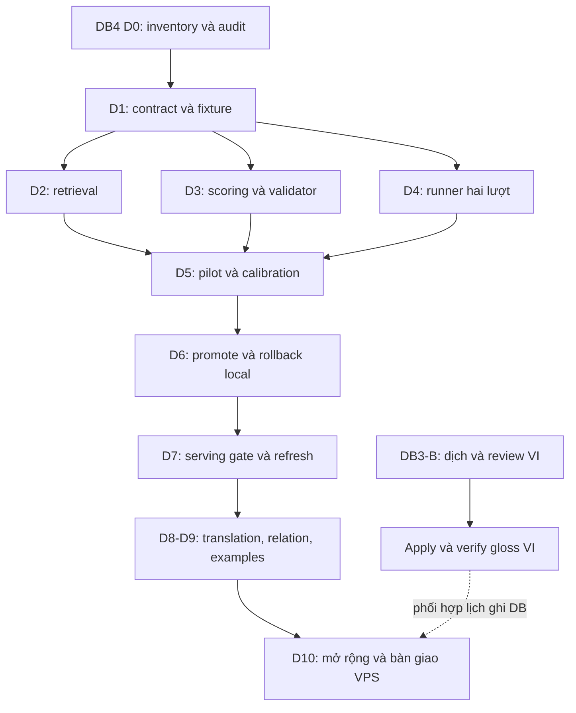

# Kế hoạch DB4 — Mapping sense ↔ concept và xử lý liên kết nội dung

> Ngày: **06/10/2026** · Cập nhật **08/10/2026**: D1 contract và D2 source/MiniLM adapter đã kiểm local; DB4 tổng thể còn semantic pilot/apply/serving.
> Chủ dự án yêu cầu plan chi tiết; DB4 chuẩn bị và phát triển song song với dịch DB3-B. DB3-C đã hủy.
> Phạm vi triển khai được duyệt theo từng chặng trong `PROMPT-BACKEND.md`; phiên viết plan chỉ đọc dữ liệu local và viết tài liệu, chưa gọi LLM, ghi DB, migrate, deploy hoặc push.

## 0. Cách đọc và quyết định thiết kế

- §1–4: kết quả cần đạt, dữ liệu thật, phụ thuộc và bất biến.
- §5–8: quan hệ nghĩa, nguồn/context, retrieval và scoring.
- §9–12: contract, hai lượt LLM, runner và pilot/gate chất lượng.
- §13–15: ghi candidate/review, promote, rollback và serving.
- §16–18: translations, sense relations và examples.
- §19–23: mở rộng, file/CLI, test, chia việc và bàn giao.

Các thông số top-K, cap, pilot và gate trong tài liệu là **đề xuất triển khai**, chưa phải benchmark hoặc quyền chi tiền. Những con số baseline có nơi đo riêng. Chốt contract bằng code/schema/fixture trước khi hai phiên bắt đầu phần phụ thuộc.

### 0.1 Quyết định mặc định trong plan

| Nội dung                   | Đề xuất                                                                                                |
| -------------------------- | ------------------------------------------------------------------------------------------------------ |
| Lõi DB4                    | Nối sense hiện hữu với concept hiện hữu, giữ đúng phạm vi nghĩa                                        |
| Ưu tiên                    | Toàn bộ sense của lexeme JLPT accepted, trải N5→N1; tiếp theo mới mở EN Wiktextract/JA ngoài JLPT      |
| Context chính của sense JA | Toàn bộ EN gloss cùng sense, raw sense attributes; definition có khai báo ngôn ngữ nếu thực sự tồn tại |
| Gloss VI từ DB3-B          | Dùng ở báo cáo cho người đọc; loại khỏi retrieval/scoring và input LLM mapping ban đầu                 |
| Concept VI cũ              | Chưa dùng làm định nghĩa độc lập; audit nguồn và phân biệt label với definition                        |
| Candidate retrieval        | Deterministic, giữ chứng cứ, không ghi accepted chỉ vì trùng lemma/POS                                 |
| Review semantic            | Hai lượt riêng; lượt 2 không thấy kết luận/score của lượt 1                                            |
| Reviewer pilot             | GPT/Codex AI, lưu `reviewer_kind=llm`; có thể bổ sung Claude nếu người dùng chọn công cụ đó            |
| Link máy                   | `verified=false`; không tự gán curator hoặc đổi concept sang curated                                   |
| Runtime/API                | Công cụ offline; API vẫn đọc core/serve, không mở route ghi mapping                                    |
| DB write                   | Dry-run mặc định; đợt apply cụ thể có guard đích, journal và review artifact                           |
| Dependency/npm             | Node 22, TypeScript, `pg`, `zod` và dependency hiện có                                                 |
| Môi trường                 | Full local để inventory/retrieval; DB test riêng để thử mutation; VPS vận hành sau kiểm chứng lineage  |

### 0.2 Nghiên cứu bổ sung ngày 07/10 — DB4-D2/DB4-D4

[Nghiên cứu hướng mapping sense–concept](db4-mapping-methods-research-2026-10-07.md)
so sánh mapping theo danh tính nguồn, retrieval + AI, graph alignment, so sánh
nhóm sense và các công cụ/dữ liệu có sẵn. Đề xuất giữ hướng hybrid, ưu tiên
JLPT N5/N4 và nghiên cứu Muse thay provider OpenCode đã bỏ vì chậm. Chưa có
benchmark Langoo cho các hướng bổ sung; tài liệu mới chưa thay policy hai lượt
R1/R2 hoặc contract DB4-D1 và chưa xác nhận trạng thái luồng triển khai khác.

### 0.3 Triển khai ngày 08/10 — DB4-D2 nguồn đã xác minh + MiniLM

Chủ dự án đã cho triển khai hướng hybrid phần source/retrieval. Có
[plan adapter](db4-d2-source-minilm-retrieval.md),
[handoff](../handoff/db4-d2-source-minilm-retrieval-2026-10-08.md) và
[review smoke](../reviews/db4-d2-source-minilm-retrieval-2026-10-08.md).
READ ONLY export thật 100 sense / 41 lexeme JMdict N5/N4, audit scoped nguồn gốc
JMdict/OEWN/OMW EN/JA, MiniLM ONNX local toàn pool 120.875 concept; xuất 345
candidate / 69 bundle, 31 no-candidate. Đây là smoke retrieval, chưa pilot semantic.

Adapter CLI `retrieval-export.ts` / `mapping_minilm.py` / `retrieval-generate.ts`
không thay orchestration parser frozen D1; giữ toàn EN gloss/raw attributes và
identity/status sidecars. Direct WordNet identity có audit, không auto-accept
JMdict theo ILI/spelling. Chưa commit/push/deploy/apply, chưa gọi Muse/OpenCode.
Full source/legacy audit, EN Wiktextract adapter, recall@5, D4 R1/R2, D5 gate
và D6/D7 mutations/serving vẫn còn thiếu.

### 0.4 Yêu cầu ngày 10/10 — Vận hành không cần người duyệt từng mapping

Chủ dự án chốt mục tiêu tự động toàn bộ luồng. Review semantic không yêu cầu
người vận hành biết JA/EN hoặc duyệt từng dòng. D3 dùng đánh giá Muse R1/R2 cùng
rule D1 để accept/defer; D6/D7 tự preflight/apply/journal/refresh khi các gate đã
được triển khai. Không yêu cầu thêm provider để chạy luồng. Quyết định máy giữ
`verified=false`; audit đúng reviewer kind, không giả danh người duyệt/curator.

Trường hợp mơ hồ/không có candidate tự đi qua retrieval/repair có giới hạn rồi
giữ unresolved nếu không đủ bằng chứng. Không ép mọi sense phải có mapping;
không biến unresolved thành bước bắt người dùng duyệt. Gloss tra từ hiện hữu
vẫn sử dụng được khi sense chưa map concept.

Chi tiết policy và phân loại pilot 20/4/44/1 trong
[plan DB4-D4 §6.1](db4-d4-semantic-match-prompt-v1.md#61-yêu-cầu-vận-hành-tự-động--chốt-ngày-10102026).
Đây là yêu cầu thiết kế/triển khai, chưa phải quality gate đã pass hoặc quyền
tuyên bố mọi machine mapping đúng. Accuracy chưa được đo; D5 phải báo rõ
reference/audit tự động thực tế và độ tin cậy, không coi hai lượt cùng model là
hai nguồn kiểm chứng độc lập. Human review không là điều kiện bắt buộc vận hành.

### 0.5 Triển khai ngày 10/10 — DB4-D3 quyết định tự động

[Engine/CLI DB4-D3](db4-d3-auto-decisions.md) tạo quyết định consensus D1 từ
artifacts Muse đã có, không gọi provider hoặc ghi DB. Run local trên 100 target:
20 exact proposals, 44 bundle deferred, 4 shortlist all-none, 1 thiếu phase,
31 no-candidate; chưa chứng minh precision.
[Report/gate còn thiếu](../reviews/db4-d3-auto-decisions-2026-10-10.md).
Code/test đã lưu; D5 chất lượng/D6 mutation/D7 serving và vận hành VPS còn chờ.

### 0.6 Audit ngày 10/10 — DB4-D5 proposal exact

[Tool và phạm vi D5](db4-d5-proposal-audit.md) đã audit đủ 20 exact proposals:
16 pass, 2 fail/severe, 2 deferred theo AI reviewer Codex. Muse R1/R2 cùng đồng
ý những ca lỗi scope; consensus không đủ cấp quality gate. Hash-bound audit
và subset pass giữ riêng, không sửa output cũ hoặc ghi DB.
[Report từng dòng, gate và hướng sửa](../reviews/db4-d5-proposal-audit-2026-10-10.md).
Đây chưa là audit toàn 100 target/Pilot B; D5 gate fail hiện tại, D6/D7 còn chờ.

## 1. Mục tiêu, phạm vi và định nghĩa hoàn thành

### 1.1 Mục tiêu sản phẩm

1. Một sense JA/EN được gắn với concept phù hợp **đúng nghĩa**, không gắn toàn lexeme theo cách viết.
2. Phân biệt exact/broader/narrower/related; gặp nhiều nghĩa, thiếu concept hoặc thiếu nguồn thì giữ unresolved.
3. Mọi quyết định truy được về nguồn, context, phiên bản thuật toán/prompt/model, hai lượt review và run đã promote.
4. Có thể dừng/resume, hạn chế chi phí, áp dụng lại không tạo trùng và rollback đợt cụ thể.
5. Dọn hàng đợi translation/relation/example theo từng family, không biến kết quả lexical thành liên kết semantic tự động.
6. Báo cáo coverage tách rõ candidate, accepted, exact, curated và actually served.

### 1.2 Phạm vi theo đợt

| Đợt                  | Đầu ra                                                                                          | Điều kiện                                               |
| -------------------- | ----------------------------------------------------------------------------------------------- | ------------------------------------------------------- |
| Lõi                  | Inventory, contract, retrieval, scoring, hai lượt review, pilot, promote/rollback sense↔concept | Làm trước; không chờ VI dịch xong                       |
| Serving              | Kiểm tra/sửa gate exact, dedupe cặp, refresh và regression API                                  | Gate bắt buộc trước mở liên kết mới cho người học       |
| Translation/relation | Phân giải đích và quan hệ của các khẳng định nguồn hiện có                                      | Contract family riêng và pilot riêng                    |
| Examples             | Import/reuse câu canonical, gắn sense và concept có chứng cứ                                    | Dùng artifact Tatoeba DB3-B + nguồn JMdict; pilot riêng |
| Mở rộng              | Nâng coverage JLPT, rồi EN Wiktextract/JA ngoài JLPT                                            | Chất lượng/nguồn/ngân sách đạt gate trước từng đợt      |

### 1.3 Các phần có chủ sở hữu riêng

- M14 quản lý curation concept/gloss, quyền admin, audit thao tác nội dung và media route.
- DB5 quản lý chuyển API sang DB full, vận hành go-live và đối chiếu dữ liệu đích.
- DB3-B tiếp tục dịch/seed gloss VI; DB4 không sửa output dịch để làm mapping dễ hơn.
- Việc tạo concept mới, sửa ILI, hợp nhất/tách sense, dịch thêm định nghĩa hoặc thay nguồn cần thiết kế riêng. DB4 v1 báo `no_suitable_concept` thay vì tự tạo concept.
- Deck có anchor sense hiện hữu vẫn giữ anchor. Nếu cần điền `deck_item.concept_id`, thiết kế đợt riêng với điều kiện exact/duy nhất/curated và ảnh hưởng clone; không gộp vào promote mapping mặc định.

### 1.4 Hoàn thành DB4 được đo như thế nào

**Hoàn thành tooling:** các family trong scope có contract, dry-run, review, journal, test và runbook. **Hoàn thành một đợt dữ liệu:** toàn bộ target của manifest đã được xử lý hoặc có lý do unresolved rõ, gate đạt, apply/verify/rollback drill thành công. Không yêu cầu mọi sense phải có concept.

Concept draft có thể nhận mapping accepted đủ chứng cứ nhưng chưa phục vụ song ngữ. Mapping accepted không tự hoàn thành curation M14; view rỗng do không có concept curated là kết quả đúng, không phải lỗi cần lách gate.

## 2. Baseline có bằng chứng

### 2.1 Kiểm kê trực tiếp ngày 06/10

Đo bằng transaction `REPEATABLE READ READ ONLY` trên **`127.0.0.1:55433/langoo`, PostgreSQL 16.2**. SQL và kết quả lưu ở [db4-baseline-2026-10-06.json](../reviews/db4-baseline-2026-10-06.json). Thời điểm bắt đầu: `2026-10-06T02:14:53.452Z`. Đây là local full, chưa xác nhận lại VPS trong phiên này.

| Chỉ số                                          | Kết quả                                                           |
| ----------------------------------------------- | ----------------------------------------------------------------- |
| Lexeme JLPT accepted                            | 7.285                                                             |
| Sense thuộc phạm vi JLPT                        | 15.245; primary 7.285, secondary 7.960                            |
| Sense JLPT đã có `sense_concept`                | **0**                                                             |
| Concept                                         | 120.875, tất cả draft và có `gloss_en` không rỗng                 |
| Link `sense_concept` hiện hữu                   | 577.525, tất cả relation exact và verified=true                   |
| Candidate semantic                              | **685.757 pending**                                               |
| Candidate method `jmdict_form_pos_wordnet_ja`   | 45.219; phủ 13.079 sense JLPT                                     |
| Candidate method `wikt_exact_lemma_pos_wordnet` | 640.538                                                           |
| JLPT chưa được generator cũ đề xuất candidate   | 2.166 sense                                                       |
| Review semantic cũ                              | **3.200 lượt LLM**, tất cả có artifact_hash                       |
| Translation candidate                           | 82.355 pending — baseline B0 đã xác nhận không có target_sense_id |
| Sense relation candidate                        | 3.275 pending                                                     |
| `serve.sense_pair`                              | 0 dòng                                                            |
| Synset OEWN 2024                                | 120.630                                                           |
| Synset OMW EN 1.4 / JA 1.4                      | 117.659 / 57.184                                                  |
| Staging JMdict / WordNet synset                 | 218.794 / 295.473 dòng                                            |
| Staging Tatoeba sentence / directed link        | 2.319.079 / 872.814 dòng                                          |

`pg_stat_user_tables.n_live_tup` trong DB restore không đủ tin cậy để kết luận staging rỗng; baseline dùng COUNT thật cho bốn bảng trên.

### 2.2 Lịch sử LLM cần kiểm tra trước tái sử dụng

Các review cũ mang reviewer `jev-1.13-free`, với prompt `jev-validation-v2-independent`, `jev-jlpt-stratified-v3-independent`, `jev-jlpt-noul-v4`, `jev-jlpt-noul-v4-independent`. Không suy từ tên model rằng endpoint đó hiện còn dùng/free.

Nhóm `noul+choice` 1.000 lượt có 20 exact, 22 broader, 26 narrower, 175 related, 644 none, 113 uncertain. Đây là **nhãn do LLM cũ trả**, chưa phải gold label hoặc precision đã đo. Các lượt `noul` còn lại có relation NULL; cần đọc schema result và artifact gốc để biết câu hỏi/kết quả thật, không diễn giải NULL thành none.

Việc cần làm D0:

1. Group theo generation run, review run, prompt, model, candidate và input hash nếu có.
2. Resolve artifact_hash ra file thật; thiếu file hoặc thiếu context binding thì ghi `legacy_unverifiable`.
3. Kiểm tra review thực sự độc lập và có cùng candidate/context phiên bản nào.
4. Chỉ chuyển thành evidence lịch sử sau khi adapter đã test; giữ nguyên review DB cũ.
5. Score 0,35/0,45 của generator lexical cũ là heuristic, không phải xác suất hoặc bằng chứng exact.

### 2.3 Bằng chứng DB3-B dùng làm đầu vào

- [B0](../reviews/db3-b-inventory-2026-10-05.md): 41.123 EN gloss / 15.245 sense JLPT; tất cả nguồn JMdict; definition trong tập ưu tiên là 0.
- [B1](../reviews/db3-b-harvest-2026-10-05.md): 15.245 needs_translation; 34.758 pivot ambiguous; 5.368 concept VI blocked_source.
- [Example harvest](../reviews/db3-b-example-candidates-2026-10-05.md): 8.477 cặp JA–VI unique, từ 872.814 directed Tatoeba links; tất cả alignment unmapped.
- [Pilot v2](../reviews/db3-b-pilot-v2-2026-10-06.md): lỗi rút gọn nhánh nghĩa cho thấy một sense JMdict có thể rộng hơn một synset WordNet. Không coi bản VI là input đã hoàn hảo.

Các số trên là snapshot của các báo cáo được dẫn. D0 đo lại count/hash, không ép dữ liệu mới khớp con số cũ nếu snapshot đã đổi.

### 2.4 Code tham khảo và schema nguồn sự thật

`data-Langoo/scripts/run_mapping.py` đã có foundation/examples/JLPT/translations/relations/candidates/report. Generator hiện ưu tiên trùng form/lemma + POS, top-K=5, ghi pending. Dùng để hiểu join/provenance và làm fixture; implementation backend tiếp tục Node/TypeScript.

Schema: migrations 005, 007, 009–014, 016, 025, 032. Đặc biệt 014 đã bỏ metadata lớn khỏi `source_entry_identity`; không viết query dựa vào các cột language_id/word/pos/attributes đã bị drop ở bảng này.

## 3. Song song với DB3-B và môi trường



### 3.1 Phần có thể tiến hành ngay

D0 inventory/audit/SQL plan/source export và D1 đặc tả contract/fixture chạy read-only/offline. Sau khi plan/interface được chốt, D2–D4 code và mock tests có thể chạy trong lúc provider DB3-B đang dịch. DB4 không phụ thuộc việc thêm VI vào `sense_gloss`.

D5 gọi LLM có cap riêng; không dùng thời gian chờ dịch làm quyền gọi thêm hoặc tăng tổng ngân sách. D6/D7 có thể dùng fixture rồi local target được chỉ định; trước apply VPS phải có review đợt, kiểm đích và lịch một writer.

### 3.2 Snapshot và drift

D0 tạo hai fingerprint:

- **semanticInputFingerprint:** hash nguồn/snapshot đã audit + stable identity + toàn bộ content JA/EN/concept thực sự dùng + raw attrs + policy nguồn + version normalizer/retrieval. Loại VI dẫn xuất không dùng khỏi digest này.
- **promotionBaselineFingerprint:** trạng thái link/candidate quyết định, identity resolution, concept policy hiện tại, schema/migration và các dữ liệu sẽ ghi/serve cần kiểm trước apply.

DB3-B append VI không làm semantic fingerprint DB4 đổi nếu các input DB4 khác giữ nguyên. Thay EN gloss, source version, raw sense attributes, ILI/synset hoặc input normalization làm input stale; không bỏ qua drift chỉ vì count bằng nhau. Concept chuyển status có thể giữ semantic input nhưng phải kiểm lại serving/promotion policy.

Export keyset theo bigint trong một snapshot nhất quán. Không giữ transaction read-only mở suốt thời gian gọi LLM; đóng snapshot sau export và dùng artifact đã hash. Resume kiểm artifact, không đọc context sống để thay input giữa job.

### 3.3 Môi trường và tài nguyên

- Origin inventory: full local `127.0.0.1:55433/langoo`, chỉ đọc mặc định.
- GPT mutation tests: `langoo_parallel_gpt_db4_test`; DeepSeek runner/retrieval tests: `langoo_parallel_deepseek_db4_test`, port local theo setup đã cấp. Mỗi phiên tự xác minh DB mới trước tạo/reset; không dùng DB test của phiên kia.
- Không mặc định hai worktree cũ chứa HEAD mới. Tích hợp base/contract trước chia nhánh DB4; giữ công việc DB3-B đang chạy trong worktree hiện có.
- Artifact dev `uploads/db4/`; VPS đề xuất `/opt/langoo/storage/db4/`, ngoài release `/opt/langoo/app`, cùng chiến lược backup DB + artifact.
- VPS trong runbook 05/10 chỉ 1 vCPU/2GB RAM; staging raw trên VPS không đầy đủ. Retrieval nặng/export raw ưu tiên local; chuyển bundle đã audit, tránh nạp toàn corpus trong RAM VPS.
- Mục tiêu ban đầu: một worker, pool nhỏ, RAM worker ≤512MiB đo thực tế, batch đọc ≤2.000 dòng. Chưa đạt thì giảm batch/cache; không lấy cấu hình này làm số đã benchmark.
- Khảo sát DB4-D0 ngày 06/10 xác minh API VPS đang đọc DB thật localhost, migrations 001–037 trừ 028 đã áp. [Report VPS](../reviews/db4-d0-vps-duplicates-2026-10-06.md) và [plan projection/duplicate](db4-dictionary-deduplication.md) ghi hotfix dictionary chưa commit trên VPS, staging raw rỗng và input/serving drift cần phối hợp. Việc đã dùng DB thật không hoàn thành gate curation/serving. Kiểm lại target lúc nghiệm thu; không đổi DATABASE_URL như một bước mapping.

## 4. Bất biến và bảng nào được ghi

### 4.1 Bất biến dữ liệu

1. Không tạo lexeme/sense VI từ gloss dịch; sense_id hiện hữu giữ nguyên.
2. Không tạo/hợp nhất concept theo gloss VI hoặc lemma giống nhau.
3. Source assertion, candidate, review và accepted link là các lớp riêng.
4. VI được dịch từ EN không tạo một phiếu evidence mới; bản EN, bản dịch và hai output AI dùng cùng EN có chung dependency.
5. Cùng ILI không cho phép tự thay source synset identity; `(lexicon,synset_id)` vẫn được lưu.
6. Link nguồn WordNet hiện hữu giữ provenance/verified; máy không giành ownership bằng cách upsert trùng.
7. Review GPT/Claude/mọi model lưu `reviewer_kind=llm`. Quyết định chủ dự án chấp nhận AI reviewer đủ cho pilot không biến thành human hoặc curator ID.
8. Mọi link mới từ thuật toán/LLM `verified=false`; không tự sửa `concept.status`, reviewed_by hoặc reviewed_at.
9. Reject giữ context hash/policy/version để tránh lặp lại vô ích. Snapshot đổi thì review lại, không blacklist một nghĩa vĩnh viễn theo text.
10. Candidate mơ hồ không được đưa vào API để bù coverage.

### 4.2 Allowlist mutation theo family

| Task                      | Bảng mutable                                                                                    | Audit/provenance                                          | Gate                                    |
| ------------------------- | ----------------------------------------------------------------------------------------------- | --------------------------------------------------------- | --------------------------------------- |
| Candidate/review import   | `core.sense_concept_candidate` trong generation run mới                                         | `core.mapping_run`, `core.sense_concept_candidate_review` | Hash/input/source audit, import dry-run |
| Sense↔concept decision    | Candidate decision/relation/score/decision_run_id; `core.sense_concept`                         | Decision run + immutable review/artifact                  | D5 đạt, từng positive được duyệt        |
| Translation resolution    | `core.translation_target_candidate` của đợt được chỉ định                                       | mapping_run + evidence đầy đủ                             | D8 translation gate                     |
| Sense relation resolution | `core.sense_relation_candidate`, `core.sense_relation`                                          | mapping_run + evidence/source refs                        | D8 relation gate                        |
| Example import/alignment  | `core.example`, `example_translation`, `example_annotation`, `example_sense`, `example_concept` | mapping_run + source/batch + journal                      | D9 family gate                          |
| Serving refresh           | `serve.sense_pair` materialized contents                                                        | Refresh artifact + serving run metadata                   | D7 và gate concept curated              |

`public.source`/`staging.import_batch` chỉ được thêm nếu đợt cần metadata nguồn dẫn xuất mới và có spec/journal riêng; ưu tiên reuse nguồn/import batch đã audit. Không ghi staging raw, glossary, app users/collections/faces, deck hoặc concept status trong tasks trên.

### 4.3 Run audit và rollback

Tách generation/import run, review run và decision/promote run. `candidate.run_id` là run sinh candidate; `candidate.decision_run_id` là run ra quyết định cuối; `sense_concept.mapping_run_id` là run sở hữu link mới. Không thay cả ba bằng cùng một ID cho tiện.

`mapping_run.status` dùng enum thật: running/dry_run/completed/failed/rolled_back. State như awaiting_review/budget_stopped/refresh_pending nằm trong artifact/parameters, không ghi vào cột status với giá trị enum không có.

## 5. Ngữ nghĩa relation và cardinality

### 5.1 Hướng quan hệ

Mọi relation sense↔concept đọc **từ sense nguồn tới concept đích**:

| Relation  | Định nghĩa                                                            | Ví dụ minh họa policy                    |
| --------- | --------------------------------------------------------------------- | ---------------------------------------- |
| exact     | Cùng phạm vi nghĩa và điều kiện dùng, không thiếu nhánh trọng yếu     | Sense mèo nhà ↔ concept mèo nhà          |
| broader   | Sense nguồn rộng hơn concept đích                                     | Sense động vật ↔ concept mèo             |
| narrower  | Sense nguồn hẹp hơn concept đích                                      | Sense mèo ↔ concept động vật             |
| related   | Có liên hệ semantic nhưng không tương đương hay bao hàm đã chứng minh | Bác sĩ ↔ bệnh viện                       |
| none      | Không có quan hệ phù hợp trong candidate set                          | Trùng từ nhưng khác nghĩa                |
| uncertain | Thiếu chứng cứ/định nghĩa để kết luận                                 | Definition thiếu hoặc sense quá tổng hợp |

Hai nhãn cuối chỉ dùng output/review; bảng link chỉ nhận bốn relation đầu. D0 đối chiếu semantics relation legacy; nếu nguồn cũ dùng hướng khác thì adapter phải khai báo đảo hướng, giữ raw value và test, không sửa hàng loạt theo tên enum.

### 5.2 JMdict sense có nhiều nhánh

- Đọc đầy đủ EN gloss, lập coverage giữa nhánh source và concept definition.
- Một nhánh khớp concept không đủ để gắn exact cho cả sense.
- Nếu source rộng hơn concept, trả broader; nếu không có quan hệ bao hàm rõ thì related/uncertain.
- Không gắn cùng sense với nhiều concept exact chỉ để cộng các nhánh thành một nghĩa. Đánh `compound_sense` và chuyển review/curation nếu cần tách sense trong tương lai.
- Hai concept đều có vẻ exact nhưng chưa chứng minh là cùng semantic identity: `ambiguous_concepts`. Không chọn theo ID nhỏ hoặc score cao hơn vài phần trăm.

### 5.3 Cardinality đề xuất v1

V1 promote tối đa **một exact mới cho một sense trong một đợt**, và kiểm toàn bộ exact đã tồn tại trước đó. Thêm exact vào sense đã có exact khác phải có review chuyên biệt, không nằm trong đường tự động v1.

Các broader/narrower/related được lưu và review riêng; ban đầu chỉ giữ candidate/review, chưa mở broad-link apply mặc định. Việc bật apply các relation này là bước policy sau D7 vì serving hiện chưa lọc relation.

PK `sense_concept(sense_id,concept_id)` không chứa relation. Nếu cặp đã có relation khác, tạo conflict report; không overwrite để thay broader thành exact. Candidate UNIQUE có relation, vì vậy D1 quy định cách quản lý hypothesis/decision để tránh tạo nhiều bản cùng cặp trong cùng generation run.

### 5.4 Nghĩa hiển thị ưu tiên và mức phổ biến

Hiện importer JMdict chọn `is_primary = (sense_no = 1)`, còn WordNet chọn sense đầu theo synset_id; API lexeme senses sort sense_no rồi sense_id. `lexeme.frequency_rank` xếp mức thông dụng của từ, không phân biệt nghĩa của cùng từ. Các dữ liệu này chưa chứng minh sense primary là nghĩa phổ biến nhất.

Mapping confidence đo mức đúng của liên kết sense↔concept; không dùng để xếp nghĩa phổ biến. Concept match tốt không làm một nghĩa hiếm trở thành nghĩa thường gặp.

Policy hiển thị đề xuất:

1. Trong câu/reading cụ thể, ưu tiên sense phù hợp ngữ cảnh, raw POS và appliesToKanji/appliesToKana; đây là relevance theo ngữ cảnh.
2. Tra từ không có ngữ cảnh: dùng thứ tự ưu tiên đã được review cho đúng lexeme nếu có. Review AI được lưu rõ `ai_estimate`; không coi đó là tần suất đo được.
3. Khi có corpus được gán sense và kiểm định, dùng tần suất sense trong corpus đã nêu rõ domain/period/coverage; sentence count Tatoeba hoặc số candidate không phải thống kê phổ biến đại diện.
4. Thiếu evidence ranking: giữ thứ tự nguồn/sense_no làm fallback, không hiển thị nhãn “phổ biến nhất”. Nhãn hiếm/cổ/chuyên ngành là tín hiệu cần xem xét, không đủ để loại nghĩa khi người dùng đang tra đúng domain đó.
5. FE có thể hiển thị 1–3 nghĩa đầu và cho xem tất cả; giữ sense_id riêng cho từng nghĩa khi thêm flashcard. UI không cắt mất các nhánh của gloss trong một sense để làm danh sách ngắn.

D0 audit nguồn primary/order và dữ liệu sense frequency thực sự có. D1 dành sidecar report cho `displayPriority`, `priorityBasis` (source_order/ai_estimate/curated/corpus_frequency), evidence refs và policyVersion nếu có đề xuất ranking. Chưa có evidence thì priorityBasis=source_order; đo tần suất để NULL. Không tự thêm cột hoặc overwrite is_primary/sense_no theo output mapping.

Việc persist ranking/đổi primary và anchor deck cần thiết kế riêng với M14/DB5, gồm ảnh hưởng deck đã clone và audit/rollback. DB4 v1 giữ nguyên target identity và báo cáo ranking thiếu chứng cứ; mapping/translation vẫn tiếp tục độc lập.

## 6. Nguồn, context và lineage

### 6.1 Sense context

| Thành phần      | Nguồn                                                                 | Quy tắc                                                                                |
| --------------- | --------------------------------------------------------------------- | -------------------------------------------------------------------------------------- |
| Identity        | sense.external_id + source, lexeme.external_id/source_entry_identity  | Khóa nguồn ổn định; thiếu identity thì unresolved                                      |
| Forms/reading   | lexeme và lexeme_form                                                 | Giữ text gốc, phân biệt reading/homograph                                              |
| EN gloss        | sense_gloss language=en, source JMdict của đúng sense                 | Toàn bộ row sort rank rồi bigint id; không chỉ lấy gloss serve đang chọn               |
| Definition      | sense.definition + definition_language_id                             | Không suy ngôn ngữ từ lexeme; chỉ thêm khi nonempty                                    |
| POS             | raw sense.attributes.partOfSpeech và lexeme.pos chuẩn hóa             | Raw sense POS ưu tiên; ghi normalization mapping/version                               |
| Scope           | appliesToKanji/appliesToKana, info/misc/field/dialect/register/domain | Giữ sắc thái, restriction và languageSource nếu có liên quan                           |
| Neighbor senses | ID + gloss + raw POS của cùng lexeme                                  | Chỉ dùng phân biệt sense; không nhập nghĩa bên cạnh vào target                         |
| Examples        | example/annotation/source refs đã kiểm đúng sense                     | Giới hạn số ví dụ, giữ original/translation và hash; không coi annotation là luôn đúng |

Ca 結構 ở pilot DB3-B cho thấy POS lexeme có thể khác POS sense. Ca ví dụ 付ける cho thấy raw example có thể không phù hợp nhóm gloss được gán. Builder ghi warning riêng; không tự phát minh missing attributes hoặc lấy mọi example liên quan lexeme làm chứng cứ target.

### 6.2 Concept context

- concept_id, ILI nếu có, POS, synset keys và source refs.
- Định nghĩa EN có trace tới concept_gloss/source synset; `concept.gloss_en` dùng như cache, phải đối chiếu lineage trong D0.
- concept_label phân biệt lemma/synonym/definition/translation. Lemma “hoa hướng dương” không tự trở thành definition của concept.
- Các definition từ nhiều lexicon giữ row/source riêng. Nếu cùng concept có định nghĩa khác phạm vi, đánh conflict; không nối tất cả text thành một câu để che khác biệt.
- EN/JA labels giúp retrieval/disambiguation; label match không thay thế semantic definition.
- Quan hệ WordNet lấy qua `(lexicon,source_synset_id,target_synset_id)`. Gộp concept không xóa identity synset gốc.
- Neighbor hypernym/hyponym/example chỉ thêm có chọn lọc với source key, phục vụ phân biệt nghĩa; không coi chúng là definition target.

### 6.3 Source audit

D0 phải có audit cho mỗi lexicon sử dụng, gồm version hoặc snapshot, raw hash, import batch, license/attribution và evidence path/hash. `wordnet-stack` ghi “nhiều” hoặc source OMW ghi “ghi nguồn” không đủ tự xác nhận quyền/attribution của từng lexicon.

Ưu tiên JMdict + OEWN EN có metadata rõ. Nhánh OMW JA/EN chỉ được vào LLM/apply khi audit lexicon đạt. Nếu bị blocked, vẫn xuất inventory/unresolved và dùng retrieval EN đã audit; không coi toàn DB4 bị khóa.

Wiktextract/OMW VI bị blocked trong B0/B1 cần audit mới trước D8 hoặc retrieval có sử dụng. Source thiếu version có thể được xác nhận bằng snapshot+hash+evidence phù hợp; không chỉ thay chữ license trong DB để vượt validator.

### 6.4 Identity và chuyển local → VPS

- Chỉ dùng bigint-string, không parse ID thành JS Number.
- Sense semantic key từ source external identity, ví dụ `jmdict:<entry>:<senseNo>`; concept key ưu tiên ILI và kiểm synset set, hoặc source-qualified synset identity nếu không có ILI.
- Candidate giữ cả local ID lẫn semantic key; hash content/source identity để phát hiện cùng key nhưng đổi nghĩa.
- Promote plan phải bind host/port/database đích cụ thể. Journal chỉ replay/rollback trên đúng đích đã ghi.
- Đem artifact local sang VPS phải có bước `bind-target`: resolve từng semantic key 1–1, đối chiếu content hash/source/batch, sinh target-binding artifact mới. Thiếu/ambiguous/mismatch thì dừng candidate đó hoặc cả child trước transaction theo policy đã định.
- Nếu ID đích khác, tạo decision artifact dẫn xuất với origin refs và mapping ID đã kiểm; giữ provider response gốc bất biến. Không sửa raw response để giả model đã echo ID VPS. Review/guard mới bind derivative artifact trước apply.
- Không cần khôi phục toàn staging VPS để chạy promote; bundle giữ raw content đã audit và target binder xác minh core/source đủ. Nếu thiếu chứng cứ cần thiết, bổ sung export hoặc dừng phần đó.

## 7. Retrieval candidate

### 7.1 Nguyên tắc

Mục tiêu retrieval là tìm các concept đáng xem xét và giữ `no_candidates` khi không có. Recall và precision được đo riêng. Legacy top-5 theo lemma/POS phủ 13.079 sense không chứng minh các concept đó đúng.

### 7.2 Các nhánh generator

| Nhánh                     | Join/khóa                                                                 | Strength                                | Rủi ro/gate                                                        |
| ------------------------- | ------------------------------------------------------------------------- | --------------------------------------- | ------------------------------------------------------------------ |
| G1 legacy candidate       | Existing sense_concept_candidate + origin run                             | Gợi ý để đối chiếu baseline             | Score cũ không dùng làm confidence; context/nguồn phải rebuild     |
| G2 JA source anchor       | Form + reading/POS/restriction ↔ JA WordNet lexeme/sense đang nối concept | Có anchor synset nguồn                  | Trùng form vẫn đa nghĩa; OMW audit đạt mới dùng                    |
| G3 EN labels              | EN gloss head/phrase ↔ concept_label EN/WordNet EN member                 | Retrieval trực tiếp bằng text           | Một EN gloss có thể là cụm/mô tả, không được giả toàn câu là lemma |
| G4 EN definition overlap  | Toàn nhóm EN gloss ↔ definition EN concept, token/phrase features         | Tìm target không có label giống         | Lexical overlap không chứng minh equivalent                        |
| G5 accepted semantic path | Link/translation nguồn đã audit, đúng sense, cùng snapshot                | Candidate có đường evidence cụ thể      | Không dùng accepted mới trong chính run như thêm phiếu độc lập     |
| G6 source relations       | Related/hypernym/hyponym có identity rõ của candidate G2–G4               | Tìm concept cạnh tranh hoặc phạm vi gần | Relation graph chỉ mở search; không tự promote exact               |

G1–G4 là scope generator đầu. G5/G6 thêm sau khi có fixture và đo cải thiện, giữ generatorVersion mới.

### 7.3 Chuẩn hóa phục vụ retrieval

- Giữ original text bất biến và textHash. Dùng representation phụ với normalizationVersion.
- EN: Unicode normalization đã chỉ định, lower-case và tokenize; giữ phrase, số và feature negation/only/without trong semantic checks.
- JA: normalization cho form lookup tách khỏi raw text; không gộp reading/homograph khi mất phân biệt.
- Không dùng VI accent stripping hoặc endpoint gloss-search; DB3-C đã hủy.
- Không hardcode language_id=1/2 như script Python cũ; resolve public.language.code và lưu map trong inventory.
- Stopword/stemming chỉ ảnh hưởng retrieval feature, không được xóa qualifier trong context LLM.

### 7.4 Top-K và thứ tự deterministic

Đề xuất ban đầu: union ≤40 concept/sense, rerank giữ ≤12, shortlist LLM ≤5. Dedupe theo semantic concept identity; giữ mọi đường evidence khác nhau nhưng collapse dependency chung.

Tie-break: score descending, source priority versioned, rồi concept semantic key/ID bigint; ghi reason khi prune. Có protected evidence anchor nhưng không ép giữ mọi anchor nếu nguồn blocked.

Nếu nguồn tạo >cap: lưu rawCount/prunedCount/pruning policy. Nếu shortlist thiếu branch hoặc known gold nằm ngoài cap, đo retrieval miss rồi sửa generator; không yêu cầu LLM chọn trong list chắc chắn không có đáp án.

### 7.5 Cách chạy trên local/VPS

- SQL dùng bound params, keyset pagination và index lookup sẵn có cho identity/label/form.
- Definition overlap cần index artifact ngoại tuyến hoặc SQL đã EXPLAIN. Export concept definitions một lần, tạo postings theo token; dùng shard/cache bounded thay vì scan 120k concept cho mỗi sense.
- Không tạo index tạm/core projection trong inventory read-only. Nếu cần schema/index mới, có migration riêng với benchmark/space/rollback.
- Token index artifact có source semantic fingerprint, config/hash/count, giới hạn RAM và kiểm hash từng shard. Hai lần cùng snapshot/config cho cùng output hash.
- Chưa thêm vector DB, embedding service hoặc dependency NLP. Có thể đề xuất sau nếu gold recall lexical không đạt, với A/B, budget và contract riêng.

## 8. Scoring và quyết định quy tắc

### 8.1 Feature đề xuất

| Feature             | Ý nghĩa                                           | Cách dùng                                                 |
| ------------------- | ------------------------------------------------- | --------------------------------------------------------- |
| identity_anchor     | Đường source synset/sense có khóa rõ              | Ưu tiên retrieval, không đồng nghĩa curator review        |
| form_reading_match  | JA form + reading đúng restriction                | Loại nhầm homograph/reading                               |
| pos_compatibility   | Raw sense POS ↔ concept POS                       | Compatible/unknown/conflict có lý do                      |
| phrase_match        | Cụm EN đặc trưng/label match                      | Tín hiệu lexical                                          |
| definition_overlap  | Token/phrase EN gloss ↔ definition                | Tín hiệu lexical có trọng số IDF/version                  |
| branch_coverage     | Mọi nhánh trọng yếu source có ở concept hay không | Điều kiện exact, kiểm semantic bằng review                |
| register_domain     | Sắc thái/chuyên ngành                             | Cảnh báo conflict, không bỏ nhãn                          |
| negation_scope      | Khác phủ định/điều kiện/participant               | Veto exact nếu đã xác định mâu thuẫn                      |
| source_quality      | Audit, version, content hash                      | Hard gate trước provider/apply                            |
| alternatives_margin | Cách biệt candidate cạnh tranh                    | Chọn cần review, không tự coi margin là xác suất          |
| legacy_outcome      | Review cũ đã xác minh input                       | Evidence lịch sử, không cộng phiếu nếu cùng context/model |

D3 chốt công thức lexical sau D0/D2 EXPLAIN và fixture. Score đầu chỉ là rank score [0,1], lưu feature vector/công thức/version. `calibrated_score=NULL` cho tới khi có tập nhãn và báo cáo calibration hợp lệ.

### 8.2 Veto và unresolved

Các reason code tối thiểu: `blocked_source`, `missing_identity`, `missing_context`, `pos_conflict`, `restriction_conflict`, `definition_conflict`, `compound_sense`, `ambiguous_concepts`, `no_candidates`, `no_suitable_concept`, `retrieval_miss`, `context_too_large`, `legacy_unverifiable`, `stale_input`, `review_disagreement`, `budget_exhausted`.

Không coi unknown POS là conflict tự động; vẫn giảm khả năng ra quyết định nếu thiếu chứng cứ. Không dùng rule tương thích noun/adjective quá rộng để cứu mapping sai. Sense particle/counter/interjection không có synset phù hợp được phép unresolved.

### 8.3 Decision policy ban đầu

- Hai lượt đều exact, branch coverage đầy đủ, không veto, không alternative exact mơ hồ → proposal `accept_exact`, còn cần pilot gate và AI audit theo §12.
- Hai lượt đồng ý broader/narrower/related → proposal `accept_nonexact`, v1 giữ artifact/candidate; chỉ apply khi policy nonexact được mở và D7 đạt.
- Hai lượt đều none, chứng cứ đủ và không phải retrieval miss → proposal `reject_pair` cho cặp đó, không reject toàn sense vĩnh viễn.
- Một uncertain, output invalid, disagreement, thiếu branch/evidence → `defer` với reason.
- R1 chọn none of the above nhưng R2 tìm concept ngoài shortlist không được thêm ID mới; chuyển retrieval_miss và generator run mới.

### 8.4 Calibration và thống kê

Tách tập development/calibration khỏi holdout theo lexeme/source identity để sense cùng lexeme không rò giữa hai tập. Không chọn threshold trên holdout rồi công bố holdout độc lập.

Ở pilot đầu, proposal được AI reviewer audit từng dòng; không auto-promote chỉ theo điểm LLM. Nếu muốn dùng calibrated_score ở đợt lớn: tạo tập nhãn tối thiểu đề xuất 500 cặp, gồm ≥100 positive và hard negatives, fit/calibrate deterministic, report reliability/precision/recall theo bucket và kiểm holdout mới. Thiếu dữ liệu → tiếp tục NULL, không gán self-confidence LLM thành calibrated_score.

`confidence` của link phải ghi cách tính/version và conservative policy đã duyệt. Giá trị ≥0,7 chỉ là gate hiện hữu của serving, không đủ chứng minh mapping đúng. Tỷ lệ mẫu 99/100 cần kèm denominator và khoảng tin cậy; không cam kết toàn dataset có precision 99%.

## 9. Contract artifact v1 — phải chốt trước chạy song song

**D1 triển khai local 06/10/2026:** contract chính thức ở
[db4-schema-v1.md](db4-schema-v1.md), entrypoint `scripts/db4/_mapping-types.ts`.
Có candidate/bundle/output/decision/audit/job/gate validators, hash/state/CLI và fixtures
offline. Phần dưới là thiết kế tổng quan; field/hash/flags thực tế lấy theo spec v1.
D0 source audit, commit/tích hợp cùng base và consumer review chưa thay bằng fixture.

### 9.1 Các family và đơn vị

Contract đầu tiên `candidateType='sense_concept'`. Pair candidate, sense bundle, provider response, review và decision là các artifact riêng. DB3-B gloss/example contract giữ nguyên.

Các family sau có schema riêng/version riêng: `translation_target`, `sense_relation`, `example_sense`, `example_import`, `example_concept`. Validator từ chối nhận nhầm family. Không thêm field mapping vào `_example-types.ts` DB3-B để tái dùng file unmapped như file đã duyệt.

### 9.2 Pair candidate

| Field                    | Type/constraint                                                                                                           |
| ------------------------ | ------------------------------------------------------------------------------------------------------------------------- |
| schemaVersion            | literal 1                                                                                                                 |
| candidateType            | literal sense_concept                                                                                                     |
| pairKey                  | SHA256 semantic fingerprint + sense semantic key + concept semantic key                                                   |
| candidateKey             | SHA256 family/version/pairKey/inputHash/generatorVersion                                                                  |
| inputHash                | SHA256 canonical JSON toàn input semantic và provenance dùng để đánh giá                                                  |
| semanticInputFingerprint | SHA256 snapshot input DB4                                                                                                 |
| sense                    | id/lexemeId bigint-string, semanticKey/source external key, language, lemma, reading, forms, senseNo, primary, JLPT level |
| senseContext             | EN rows, definition/lang nếu có, raw attrs, normalized POS/version, restrictions, neighbors/examples có provenance        |
| concept                  | id bigint-string, semanticKey, ILI nullable, sorted synset keys, POS                                                      |
| conceptContext           | definition rows, typed labels, selected neighbors/examples có provenance                                                  |
| evidence                 | Array typed evidence refs; stable key, source/batch/hash, dependencyGroup, sourcePath, method                             |
| sources                  | Audit metadata/ref đã xác minh; không tự tin theo code nguồn                                                              |
| hypothesisRelation       | exact/broader/narrower/related; đây là giả thuyết retrieval, chưa là verdict                                              |
| retrieval                | generatorVersion, branch names, rank, rankScore, features, pruning refs                                                   |
| classification           | ready/blocked_source/missing_context/unresolved/stale                                                                     |
| reasons                  | Array reason code + detail; không nằm thay cho structured evidence                                                        |

Context text giữ original; canonical hash sort object keys, giữ array order đã chuẩn hóa và null; từ chối undefined/bigint JS/non-finite numbers/extra fields. ID sort bằng BigInt; không stringify floating score khác nhau giữa hai runtime để đổi hash vô tình.

### 9.3 Sense bundle

`bundleKey = hash(schemaVersion, senseKey, ordered candidateKey/inputHash list, builderVersion, semanticInputFingerprint)`.

Bundle chứa một sense target, toàn context source, shortlist concept context và typed evidence. Builder **không gửi** lexical rankScore, decision legacy hoặc kết luận R1 trong semantic prompt; audit giữ các dữ liệu đó ở sidecar. Bảo toàn ID/key→label map. Có `contextHash` và byte/token reservation; không cắt giữa sentence/definition hoặc bỏ source branch để vừa cap.

`contextHash` bind semantic bundle canonical chung cho hai lượt. `renderedContextHash` bind payload thật của từng phase, gồm thứ tự/label map; hai hash rendered có thể khác do shuffle. Attempt/response phải bind đúng phase và rendered hash tương ứng, còn verdict echo contextHash chung. Không dùng điều kiện hai rendered hash bằng nhau để kiểm independence.

Candidate label A/B/C được shuffle deterministic theo seed riêng của R1/R2, giữ mapping trong artifact. Cache key có renderedContextHash/seed để không reuse output có label map khác. D1 chốt liệu output dùng candidateKey trực tiếp hay local label; mặc định candidateKey để validator không phụ thuộc vị trí.

### 9.4 Output mỗi lượt

| Field                             | Constraint                                                        |
| --------------------------------- | ----------------------------------------------------------------- |
| schemaVersion                     | 1                                                                 |
| task                              | sense_concept_review                                              |
| bundleKey/senseId/contextHash     | Echo đúng input                                                   |
| reviews[]                         | Đủ từng candidate trong shortlist, không trùng/thiếu/extra        |
| candidateKey/conceptId            | Echo đúng candidate, không tự đề xuất ID ngoài list               |
| relation                          | exact/broader/narrower/related/none/uncertain                     |
| coveredBranches / missingBranches | Source evidence keys/branch refs đã có trong input; không bịa ref |
| conflicts                         | Typed code + source/concept evidence refs                         |
| reason                            | Lý do ngắn, có giải thích phạm vi nghĩa; không chỉ yes/no         |
| confidence                        | Nullable self-reported [0,1], audit-only                          |
| noSuitableCandidate               | Boolean nhất quán với verdict list                                |
| unresolvedReason                  | Nullable; required nếu không đủ context hoặc ambiguity            |

Nếu branch không thể chia deterministic, builder dùng gloss row refs và review phải giải thích các nhóm đồng nghĩa; không tạo branch definition bằng một lượt LLM rồi coi đó là nguồn gốc độc lập.

### 9.5 Review/gate artifact

Mỗi record bind candidateKey/inputHash/outputHash R1/outputHash R2/decisionHash, reviewerKind/reviewerId, reviewedAt, verdict pass/fail, severity none/minor/severe, reason và suggestedDecision riêng. `reviewerId` mô tả model/phiên có thật; không đặt tên GPT mặc định cho output model khác.

Gate artifact bind toàn pilot manifest và ordered target keys, policyVersion, counts/denominators, sample seed, exclusions, budget usage và hash report. OutputHash là hash JSON đã validate; response raw hash giữ riêng.

### 9.6 Job/checkpoint

Tối thiểu có jobKey/task/schemaVersion/snapshot refs/provider configs R1/R2/prompt versions/model IDs/policy versions/session IDs/seed/caps/usage/entries/children/status.

State per target: queued → r1_running → r1_received → r1_validated → r2_running → r2_received → r2_validated → decision_ready → awaiting_audit → eligible → imported → promoted. Nhánh blocked/rejected/deferred/error/stale tách biệt. `received` chưa có nghĩa schema hoặc semantic pass.

Mỗi attempt có monotonic index, startedAt/outcome, response ref/hash, usage, retry reason và unknown marker. Chỉ một in-flight attempt trong phase; state transitions validator bắt buộc. Mutation state trong journal tách provider job state.

### 9.7 Hash và cache

- Provider cache key bind model/provider/protocol/promptVersion/rendered context hash/phase/response schema/reasoning config; không dùng lemma làm key.
- R1 và R2 cache namespace khác; R2 không đọc cache R1 như lượt đánh giá mới.
- Budget caps/session usage không đổi semantic input nhưng được audit trong job; chạy lại cùng input có thể reuse validated cache đúng config.
- Review sửa quyết định là artifact mới; không overwrite provider response/cache/checkpoint để vượt gate.
- Tái dùng reject chỉ khi pairKey + inputHash + policyVersion + reviewer/prompt requirements còn hợp lệ. Input đổi thì candidate mới, giữ predecessor ref.

## 10. Hai lượt semantic review

### 10.1 Lượt 1 — đầy đủ phạm vi

Nhiệm vụ: đọc đúng sense JA, toàn EN group, raw POS/restrictions và từng concept definition; đánh quan hệ từng candidate; nêu branch thiếu và alternative ambiguity. Luôn có đường no suitable concept/uncertain.

Không yêu cầu chọn một concept duy nhất bằng mọi giá. Không dùng gloss VI để “chứng minh” EN đã dịch đúng. Không đánh exact nếu chỉ cùng topic, cùng headword hoặc một phần sense tổng hợp.

### 10.2 Lượt 2 — phản biện độc lập về input

Input semantic giống R1 nhưng thứ tự concept đổi, không có kết luận/score/reason R1 hay lexical rank. Nhiệm vụ kiểm đúng phạm vi, tìm counterexample, xác định chiều broader/narrower và kiểm tất cả nhánh của source.

Ưu tiên model khác khi có provider đã xác minh và budget cho phép. Nếu cùng model với prompt/seed khác, ghi `same_model_two_pass`; không quảng bá hai lượt đó là hai bằng chứng thống kê độc lập. Hai lượt dùng chung dictionary source có chung dependencyGroup dù model khác.

### 10.3 Prompt version dự kiến

- `mapping-sense-concept-r1-v1`: matching/coverage.
- `mapping-sense-concept-r2-v1`: adversarial scope/relation direction.
- `mapping-decision-v1`: rule consensus, không cần lượt LLM thứ ba.

Prompt yêu cầu JSON strict, exact echo identity, source text là untrusted data, không gọi tool/web, không thêm concept ngoài shortlist. Reason giới hạn độ dài; không lưu hoặc yêu cầu chain-of-thought. Có fixture chống nhầm thin, way, director, tự động, đối xử và compound sense.

### 10.4 Provider và key

Dùng adapter riêng DB4; preflight xác nhận endpoint/model/protocol/rate/reasoning/quota ở thời điểm chạy. Go/Muse là cấu hình DB3-B hiện có, chưa được xem là model mapping đã benchmark. Chưa chọn model free khác dựa trên tên catalog cũ.

`DB4_AI_R1_*`, `DB4_AI_R2_*`, `DB4_AI_*CAP*` tách khỏi DB3/chat. Reviewer GPT trong phiên đọc artifact có thể bổ sung audit, không được ghi như API round2 đã chạy nếu chưa có response thật. Không có provider R2 thì mock đủ tooling, pilot thật ghi thiếu gate R2.

## 11. Runner, quota, lỗi và resume

### 11.1 Lệnh chỉ đọc và lệnh gọi provider

Inventory/retrieval/scoring/dry-run không gọi AI và không ghi DB. `--generate` là flag bắt buộc để gọi provider; reject cờ mâu thuẫn/không biết. Import/apply dùng CLI riêng để giảm nhập nhầm.

### 11.2 Cap đề xuất pilot A

- 100 sense target unique × 2 lượt = 200 request thành công lý tưởng.
- `maxRequests=220` bao gồm preflight được tính vào job, retry và cả hai phase. Không chia hai cap 220 rồi tiêu tổng 440.
- `maxCostUsd=0.10` là trần đề xuất ban đầu; rate phải được xác minh/khai báo trước chạy. Không phải dự đoán phí hoặc quyền nạp thêm tiền.
- Concurrency tổng 1 cho lần pilot đầu; không chạy hai worker R1/R2 vượt cap chung.
- Context shortlist ≤5, ví dụ được chọn ≤2 mỗi target; toàn source gloss giữ đủ. Context lớn phải block hoặc build lại shortlist/policy với version mới.
- Output/context token cap và reasoning effort chốt sau mock/preflight để đủ schema cho 5 candidate; không copy `1200` của gloss translator rồi mặc định đủ.
- Provider timeout đề xuất 60s, retry tối đa 2 lần cho 429/5xx; vẫn bị chặn bởi tổng cap.

### 11.3 Reservation trước request

Reserve request, token và cost upper bound trước dispatch, gồm prompt/context + max output + reasoning theo provider. Rate thiếu/không hợp lệ hoặc budget không đủ → stop trước request.

Usage ledger có budgetGroup nếu DB3/DB4 dùng cùng tài khoản để người vận hành nhìn tổng; hai job cap độc lập không cho phép vượt số tiền tài khoản đã chốt. Response không báo usage thì đánh unknown/giữ reservation, không tính phí 0.

### 11.4 Retry và unknown

- 429 honor Retry-After; 5xx/transport retry có backoff+jitter bounded.
- 401/403/402 hoặc invalid model/protocol dừng phase/job; không quay sang provider trả phí tự động.
- Request timeout/disconnect sau dispatch có thể đã bị tính phí: lưu unknown và reservation, không tự retry như chưa gọi.
- Schema lỗi, echo ID sai, extra/duplicate/missing verdict: giữ raw artifact, không cache thành validated; retry nếu flag/policy cho phép và còn cap.
- Null/uncertain semantic hợp lệ không phải transport error; không retry đến khi ép được exact.
- Crash sau response trước checkpoint: đọc response hash và recover, không gọi lại khi response đã durable.

### 11.5 Persistence

Atomic file write + fsync file/parent directory, path relative root, no traversal/symlink, lock per job và ledger dùng chung. File limits bounded; JSONL streaming. Duplicate output/attempt key bị reject.

Trên filesystem local hiện có thể không thực thi mode Unix như mong muốn; permission report phải dựa stat thực tế. VPS ops đặt thư mục 0700/file 0600 và backup ngoài release. Checkpoint không chứa Authorization/env/secrets.

## 12. Pilot, rubric và gate

### 12.1 Pilot A — 100 sense đa dạng

Đề xuất mỗi N5/N4/N3/N2/N1 20 sense, mỗi cấp 10 primary + 10 secondary nếu dữ liệu đủ. D0 ghi rõ cách bù strata thiếu, không giảm target count âm thầm.

Bao gồm trong sample: form đa nghĩa, nhiều sense cùng lexeme, verb/adjective/adverb, raw POS khác lexeme POS, compound sense, named entities, particle/counter/no-concept, source restriction, negation, các ca lịch sử exact/none/uncertain đã xác minh. Giữ seed, query, exclusion, hash target list.

Benchmark đánh **100 quyết định theo target**, với mỗi target tính toàn bộ verdict candidate và quyết định cuối. Có thêm pair-level metrics nhưng không đổi mẫu số cho đẹp. Target không có concept phù hợp và được defer đúng vẫn có thể pass.

### 12.2 Rubric

| Mức    | Ví dụ                                                                                                                                                   |
| ------ | ------------------------------------------------------------------------------------------------------------------------------------------------------- |
| Severe | Gắn exact sai nghĩa/sai sense; rộng/hẹp bị gọi exact; nhầm identity; thêm nhánh từ sense khác; source không kiểm được vẫn promote; giả verified/curator |
| Minor  | Lý do chưa rõ, cần thêm giải thích branch/qualifier nhưng verdict/link không sai                                                                        |
| Pass   | Target identity/nguồn đúng, các relation/none/uncertain hợp lý, đủ branch coverage, không bỏ alternative quan trọng                                     |

AI reviewer đọc JA/EN/concept gốc; VI là trợ giúp báo cáo và phải ghi nguồn dẫn xuất. Không dùng “tiếng Việt nghe hợp lý” làm ground truth. Khi reviewer không đủ chứng cứ, verdict review deferred, không tự pass cho đủ số.

### 12.3 Gate pilot A

1. Đủ 100 target unique, hai lượt validated/bound đúng input hoặc no_candidates được đánh giá và báo rõ số request thực tế.
2. **≥98/100 target decision pass và 0 severe** theo audit semantic độc lập.
3. 100% schema/identity/hash/source refs/status/cache binding hợp lệ.
4. Report exact/nonexact/reject/defer/no-candidate, nguồn và strata; không có yêu cầu tỷ lệ accept tối thiểu.
5. Mọi proposal promote trong pilot được audit từng dòng; các fail/deferred không apply.
6. Budget không vượt; skipped/unknown/incomplete không được coi là gate đã chạy.

### 12.4 Pilot B — kiểm precision trước mở rộng

Pilot A có thể chỉ có ít positive; accuracy cao do reject đúng không đủ chứng minh precision accepted.

Sau A, thu **ít nhất 100 positive proposal distinct**, cùng ≥50 hard-negative/deferred để kiểm bias. Có sampling manifest theo generator/source/POS/level, kèm holdout lexeme tách development. Không chọn chỉ ca đơn giản có score cao.

Gate đề xuất: **≥99/100 positive proposal đúng relation/scope và 0 severe**; mọi mẫu đã phát hiện lỗi phải sửa/review lại trước promote, không lấy “được phép một lỗi” làm quyền ghi một link sai. Báo CI/mẫu số và retrieval recall@5 trên gold subset được reviewer xác định là có concept trong corpus, mục tiêu ban đầu ≥95%.

Nếu không đủ 100 positive trong cap, report `insufficient_positive_sample`. Đợt thu tiếp có cap/chi phí riêng được chốt; không tiếp tục gọi vô hạn. Gate B là bước cần trước auto-policy/batch lớn; A đủ thử promote các positive đã audit trên local.

### 12.5 Bất đồng và sửa

Giữ R1/R2 và review gốc. Sửa generator/prompt/context tăng version, tạo run mới hoặc derivative decision artifact có provenance. Không sửa kết quả trong checkpoint để biến fail thành pass. Báo metric output gốc và metric sau audit/sửa tách riêng.

## 13. Import candidate/review và promote

### 13.1 Tách import khỏi promote

`mapping-import` materialize candidate/review audit vào DB sau verify; `mapping-promote` chỉ dùng eligibility/decision artifact đã được duyệt. Không gọi LLM bên trong DB transaction.

Candidate legacy có thể tham chiếu evidence, nhưng generation run DB4 mới không ghi đè legacy rows/reviews. V1 tạo candidate riêng cho context/hash/config mới, với predecessor ref.

### 13.2 Lưu hypothesis và verdict

Candidate DB `relation` bắt buộc một trong bốn nhãn. Trước consensus, đó là hypothesis từ retrieval, evidence ghi `relationStatus=hypothesis`; decision pending. Output none/uncertain lưu trong candidate_review.result/relation, không ghi vào candidate.relation.

D1/D13 phải chốt một canonical candidate per pair per generation run, không tạo duplicate khác relation trong cùng run. Khi consensus đổi relation, update hypothesis row dưới lock và kiểm UNIQUE, giữ old relation trong journal/evidence. Accepted relation chỉ sau gate/decision; `decision='pending'` không được đếm như accepted exact.

### 13.3 Review rows

Mỗi lượt có review mapping_run riêng; unique hiện có `(candidate_id,mapping_run_id,reviewer_kind,reviewer)` không bị va chạm R1/R2 cùng model. `question_type` và prompt version phân phase. Reviewer AI pilot là review record/run thứ ba hoặc artifact audit riêng, không thay review R2.

Import idempotent: run_key/jobKey/responseHash đúng thì reuse; cùng unique key nhưng khác payload/hash thì conflict dừng, không ON CONFLICT UPDATE ghi đè lịch sử. `llm_result` trên candidate chỉ là summary/ref; full response nằm artifact + immutable review rows.

### 13.4 Guard apply

- `--apply --allow-db <db>`; DB `_test` cần `--allow-test`; thêm promote-plan đã bind host/port/database và source identity/hash.
- Recompute candidate/input/output/gate/decision/artifact hashes trước connect/write.
- Re-read target sense/concept/source identity/content và candidate quyết định dưới transaction snapshot/locks.
- Existing verified link/source link hoặc curator edits có ưu tiên; conflict không bị overwrite.
- Input drift/candidate đã có decision khác → stop child, report context; không tự đổi target.
- Không set concept curated/reviewed, không đánh `verified=true` cho mapping máy.

### 13.5 Transaction và journal

Child size đề xuất ≤100 link decisions, giảm nếu lock/manifest lớn; không một transaction cho toàn 15k sense. Keyset/order deterministic.

1. Plan child ngoài transaction, persist planning journal.
2. Lấy DB4 advisory lock và lock rows/tables theo một thứ tự cố định; lock timeout đề xuất 10s.
3. Verify inputs/preconditions trong transaction.
4. Capture mutable before snapshot, apply candidate decision/link writes, capture after.
5. Persist prepared journal + fsync **trước COMMIT**.
6. COMMIT rồi persist applied; lỗi persist sau commit chuyển recovery theo prepared journal, không replay mutation mù.
7. Verify child và schedule serving refresh theo policy §15.

Các cột PostgreSQL real/numeric/time phải canonicalize ổn định; không mất microsecond timestamp hoặc bigint khi snapshot. SQL identifier từ allowlist code, không lấy từ manifest untrusted.

### 13.6 Columns khi tạo link mới

`sense_id`, `concept_id`, `relation`, `confidence`, `method`, `verified=false`, `mapping_run_id`, `decided_at`, source_id/batch_id hợp lệ. Evidence đầy đủ nằm candidate/reviews/run/artifact vì bảng link không có evidence column.

Method versioned, ví dụ `db4_semantic_two_pass_v1`. Run source_snapshot ghi nguồn thực sự dùng, parameters ghi model/prompt/policy/decision/gate hash. Không lấy batch của JMdict gán cho mọi evidence WordNet; link primary source có rationale, các nguồn còn lại nằm full evidence.

### 13.7 Existing link và no-op

- Cặp đã có cùng relation/provenance hợp lệ: report reused, không tạo row hoặc thay ownership/confidence/verified.
- Cặp có relation khác/verified curator/nguồn chưa kiểm: conflict, cần review đợt riêng.
- Existing rejected cùng input/policy: skip với ref; không xóa reject.
- Same exact concept đã có nhưng new run không sở hữu: dependency ref vào original link/run; rollback new run không được xóa link đó.

## 14. Rollback và recovery

### 14.1 Đơn vị rollback

Rollback decision/promote child hoặc cả root theo thứ tự child ngược. Khôi phục trạng thái quyết định/các liên kết mutable của run; giữ audit candidate/review/response/run lịch sử để giải thích việc đã làm.

Candidate identity và review import được giữ làm audit; decision/relation summary của candidate là phần mutable có journal. Rollback promote không DELETE review, không DELETE candidate đang được review FK tham chiếu và không xóa source/import_batch tái dùng. Các audit run có metadata phản ánh trạng thái; decision run mark rolled_back khi đã hoàn tác link.

### 14.2 Quy trình

1. Validate journal task/version/hash/đích/root-child graph.
2. Kiểm current mutable rows khớp after-state chính xác; row đã được sửa tiếp thì stop toàn child.
3. Kiểm dependencies: downstream accepted translation/relation/example hoặc job hoàn tất reuse link của run.
4. Muốn rollback parent có dependency phải rollback dependent trước; report DAG, không CASCADE tự động.
5. Reverse mutable inserts/updates trong transaction có journal rollback-prepared trước COMMIT.
6. Giữ rows audit; mark decision run rolled_back; update root artifact.
7. Refresh/verify serving. Core rollback đã commit mà refresh lỗi thì mark `refresh_pending` và block rollout đến khi sửa.

### 14.3 Cửa sổ crash

| Điểm crash                                 | Recovery                                                                      |
| ------------------------------------------ | ----------------------------------------------------------------------------- |
| Trước prepared                             | Transaction rollback; xác minh trước khi resume                               |
| Prepared trước COMMIT                      | So current with before/after; before → aborted, after → applied; mixed → stop |
| COMMIT xong, applied chưa durable          | Recover từ prepared, không insert lại                                         |
| Rollback COMMIT xong, final file lỗi       | So với restored snapshot để hoàn tất status                                   |
| Response durable, checkpoint chưa cập nhật | Recover response/usage, không gọi provider lại                                |
| Refresh failed                             | Giữ core trạng thái thật và lỗi refresh; retry refresh, không báo DB chưa ghi |

Không hoàn tác dựa duy nhất `DELETE WHERE mapping_run_id=...`; phải có journal/precondition và dependency audit. Generic DB3 `_mutations.ts` hiện chưa đủ semantics DB4 audit-only; GPT sở hữu journal DB4 riêng hoặc refactor chung có backward regression đã duyệt.

## 15. Serving gate và migration cần thiết

### 15.1 Hai điểm hiện hữu

Migration 025 hiện `serve.sense_pair` nối mọi `sense_concept` cùng concept, lọc curated và confidence≥0,7 nhưng **chưa lọc relation exact**. Khi DB4 thêm broader/narrower/related, view có thể tạo cặp được hiểu như tương đương sai.

Unique index là `(sense_a,sense_b)`, trong khi SELECT chứa concept_id. Một cặp có nhiều shared concept có thể sinh duplicate và làm REFRESH lỗi. `serve.sense_card` cũng chọn một concept bằng curated/confidence chưa lọc relation và tie-break concept ID.

D0 audit view definition thực tế và dependents, D7 xử lý trước phục vụ link mới. Không sửa migration 025 đã chạy.

### 15.2 Read model đề xuất

- sense_pair chỉ dùng **hai link exact**, concept curated và confidence gate hiện hữu.
- Dedupe mỗi directed pair `(sense_a,sense_b)`; chọn shared concept có pair confidence lớn nhất, tie-break concept_id bigint nhỏ nhất. Lưu cùng response columns hiện có.
- Giữ cả hai chiều hiện hữu; không đổi semantics direction/cursor/API contract.
- sense_card chọn concept exact phù hợp; curated trước, confidence DESC NULLS LAST, concept_id cuối làm tie-break. Gloss VI/EN và badge giữ ordering hiện có.
- Candidate/rejected/uncertain/nonexact không được giả thành bilingual equivalent.
- Không nâng concept draft lên curated để kiểm view có dữ liệu; fixture test có concept curated riêng.

### 15.2a Các query API đọc core trực tiếp

`src/collections/repositories/sense-lookup.repository.ts` và `deck.repository.ts` hiện kiểm curated/confidence nhưng chưa lọc exact ở các lookup/validation concept. D7 bổ sung exact cho các đường dùng concept để ghép nghĩa tương đương, bao gồm recheck hai mapping trong `findCuratedPair`. Giữ contract request/response hiện có; đây là gate đọc, không mở quyền API ghi core.

`src/dictionary/repositories/sense-pair.repository.ts` hiện đọc materialized view. Khi core link bị rollback/downgrade hoặc concept mất curated mà refresh chưa xong, query phải recheck hai base mappings và concept policy, tính confidence từ trạng thái hiện tại. Stale view có thể tạm thiếu link mới; không được trả link đã mất điều kiện. Test cửa sổ core COMMIT → refresh failure bắt buộc trước rollout.

### 15.3 Migration strategy

Đề xuất migration mới `<registry-number>_mapping_serving_quality.sql`; integrator cấp số sau khi kiểm HEAD/migration registry. Cần thiết khi sửa views, không thêm cột score/enum chỉ để tiện runner.

Materialized view không dùng CREATE OR REPLACE VIEW để thay definition. D7 phải kiểm dependency OID/ACL/index/owner trước chọn rebuild transactional. Nếu không có DB dependent objects: rebuild cùng tên trong transaction, recreate đúng indexes/owner/grants và populate bằng definition mới. Nếu có dependents: migration liệt kê/recreate chúng hoặc có kế hoạch swap có kiểm dependency; không DROP CASCADE không giới hạn.

Chạy migration trên fixture và bản copy full trước VPS, đo lock/disk/time và backup definition/ACL/index. DDL/migration runner chạy transaction; không mặc định runner hỗ trợ CREATE INDEX CONCURRENTLY. Schema rollback dùng migration forward sửa lại definition, không chạy data journal như DDL rollback.

### 15.4 Refresh

`serve.sense_card` là view thường; `sense_pair` materialized cần refresh riêng. Đo và chọn nonconcurrent/concurrent dựa unique index và trạng thái populated thực tế.

Refresh sau apply/rollback và sau concept curation/relevant mapping changes; cùng refresh contract bàn giao M14/DB5. Coalesce nhiều child trong một đợt nhưng không báo rollout hoàn tất trước refresh+verify cuối. Artifact ghi startedAt/finishedAt/mode/count/error/definitionHash.

Kiểm view 0 dòng do all draft là pass đúng gate; coverage accepted và curated-separated vẫn báo cáo. Test cả fixture curated để chứng minh API cặp hoạt động khi gate thật đạt.

## 16. Translation target resolution — D8a

### 16.1 Input và vấn đề thật

Assertions EN→JA/EN→VI, source_sense_id là EN; candidate hiện chủ yếu target lexeme, chưa có target_sense_id. JA→VI pivot cùng EN entry/hint chưa chứng minh sense alignment.

### 16.2 Các bước

1. Inventory assertion scope, hint, target text/reading, source identity và candidate match_method.
2. Audit source; Wiktextract thiếu snapshot/version chưa được dùng để promote.
3. Resolve target lexeme forms/reading/POS; enumerate sense đúng lexeme và EN context.
4. Candidate `translation_target` gồm assertion key + source sense nullable + target lexeme/sense + target context + source hint.
5. Hai lượt đánh giá source scope/target usage; entry-level assertion không được tự gán source_sense_id.
6. Decision target_sense chỉ khi duy nhất và đủ chứng cứ; match lemma chỉ giữ pending/uncertain.
7. Accepted translation target cập nhật đúng candidate của run; journal before/after, không sửa assertion raw.
8. Nếu muốn tạo sense_relation equivalent hoặc shared-concept link, dùng semantic family riêng và gate riêng; accepted translation không mặc định exact.

### 16.3 Schema và unique constraint

Unique hiện có `(assertion_id,target_lexeme_id,target_sense_id,match_method)` có nullable columns. Không dựa ON CONFLICT để ngăn duplicate khi target_sense_id NULL; import/resolve phải kiểm identity dưới lock hoặc có migration NULLS NOT DISTINCT/partial unique được đề xuất sau audit duplicate. Không cấp migration nếu chưa có finding/benchmark.

### 16.4 Gate và metrics

Pilot đủ entry/sense scope, EN→JA/VI, multiple homograph/sense, missing reading, mixed register và no target. Đánh precision của accepted **target sense**; report lexeme resolved và sense resolved tách riêng. Pivot JA–VI eligible chỉ khi hai cạnh sense alignment đã accepted/audited, giữ toàn dependency path; không tính 34.758 ambiguous thành số link đã có.

## 17. Sense relation resolution — D8b

- Input raw JMdict related/antonym và source relation assertions/candidates có source_key, source/target sense và reading/senseNo hint nếu có.
- Ưu tiên exact source target identity; lemma/reading/POS hỗ trợ tìm target, không bỏ ambiguity vì target lexeme có primary sense.
- Relation hướng source_sense→target_sense. Broader/narrower giữ hướng; antonym/equivalent đối xứng về nghĩa nhưng DB lưu directed edge, reverse insert chỉ có policy/source evidence rõ và journal riêng.
- `relation` enum của sense_relation dùng equivalent/related/antonym/broader/narrower, khác exact của sense_concept. Không cast tên bừa giữa hai family.
- Không suy antonym từ negation keyword đơn lẻ, related từ cùng topic hoặc equivalent từ shared nonexact concept.
- Candidate unresolved source-text không có target_sense_id giữ artifact/pending; không dùng ID 0 để thỏa schema.
- Giữ link nguồn có verified/provenance; new machine link verified=false. Conflicting existing relation hoặc target stale chuyển conflict.
- Pilot relation-direction, homograph, partial antonym, missing source sense, explicit source sense number và relation source đã bị trim. Gate accepted theo rubric, journal/recovery/coverage family riêng.

## 18. Examples và câu dịch — D9

### 18.1 Hai đơn vị khác nhau

1. **Câu JA↔VI là bản dịch của nhau:** DB3-B đã harvest 8.477 source_pair có trực tiếp Tatoeba links.
2. **Câu JA minh họa sense nào:** cần lexical occurrence + ngữ cảnh + semantic review riêng. Cặp dịch trực tiếp không chứng minh sense/concept.

### 18.2 Import/reuse canonical sentence

- Nhận artifact DB3-B example_pair v1 bằng adapter read-only, tạo candidate family mới có origin path/hash/key.
- Resolve source sentence identity theo importer convention thực tế D0; không tự đặt prefix external_id mới rồi tạo trùng.
- Core đã có nhiều example; tìm canonical phù hợp bằng source identity/language/text hash, không chỉ sentence text hoặc external ID bỏ source.
- Nếu canonical có text khác snapshot: text_mismatch, không overwrite để làm lineage khớp.
- Giữ `example.sense_id` legacy đang gán sense; không sửa NULL/khác sense để tái dùng. Nếu cần canonical unlinked mới, spec xác định rõ quan hệ annotation và unique keys trước import.
- Tạo/reuse `example_translation` theo directed edges thực trong source links; không tự sinh chiều ngược hoặc pivot EN.
- Khi pair có đủ hai chiều, có thể ghi cả hai đúng nguồn. Không lấy số 16.954 link làm số cặp unique.
- Preserve source/batch trên sentence và edge đúng loại import; batch sentence không thay batch link.

### 18.3 Candidate gắn sense

1. Từ annotation JMdict hoặc lookup form/token lấy shortlist lexeme/sense.
2. Giữ match_text/span/tokenizerVersion hoặc source annotation identity. Span dùng đơn vị Unicode đã chốt, verify trên original sentence.
3. Không substring match mọi kanji rồi chọn primary; xử lý inflection/boundary hoặc chưa có tokenizer thì source-annotation path trước, unresolved cho phần còn lại.
4. R1/R2 kiểm sense được dùng trong câu, POS/restriction và ngữ cảnh; bản VI source có thể hỗ trợ nhưng không thay lexical JA evidence.
5. Một câu có thể minh họa nhiều sense; mỗi `(example_id,sense_id)` được đánh riêng, không ép một sense toàn câu.
6. Promote `example_sense relation=illustrates`, confidence policy, verified=false, method/run/evidence. Existing candidate/rejected row cùng PK cần conflict/decision journal, không overwrite im lặng.
7. `example_concept` chỉ dẫn xuất từ example_sense accepted + sense_concept exact đã accepted, có dependency refs và cùng scope. Broad/related links không dùng để gắn concept minh họa.

### 18.4 Source annotation

`example_annotation.match_status` dùng matched/missing_snapshot/text_mismatch/pending/rejected. Việc match source sentence ID/text chỉ xác minh identity, không tự hoàn thành sense correctness. Annotation phải phân biệt identity result và semantic review result trong evidence/artifact.

### 18.5 Gate D9

Pilot tối thiểu đề xuất 100 example-sense pair, phủ source annotations đúng/sai, word đa nghĩa, inflection, nhiều occurrences, negation, no lexical occurrence, hai chiều translation và duplicate source text.

Gate ≥98/100 alignment decisions pass, 0 severe; accepted positive audit từng dòng trước local apply, precision subset khi mở rộng như §12. Report imported/reused sentence, directed translation edges, unique pair, accepted example_sense/concept và unresolved riêng.

## 19. Mở rộng và coverage — D10

### 19.1 Thứ tự đợt

1. Pilot A và positive đã audit trên local.
2. Pilot B đủ positive/hard negative, freeze policy/version.
3. Batch nhỏ đề xuất 250 sense JLPT, verify chất lượng, budget, memory/latency/journal.
4. Batch tiếp tối đa 1.000 sense theo cấp/POS/primary-secondary, tăng chỉ sau report đợt trước.
5. Xử lý hết 15.245 target priority của snapshot: accepted hoặc unresolved có reason, không ép 100% mapping.
6. D8/D9 family pilots rồi batches riêng.
7. EN Wiktextract và JA ngoài JLPT dùng scope/source audit/cap riêng; không gọi toàn 685k legacy candidate chỉ vì chúng pending.

Mỗi batch có manifest target list frozen; generator/prompt/policy đổi thì ghi metric version riêng, không gộp chất lượng của các phiên bản.

### 19.2 Báo cáo coverage bắt buộc

Theo N5→N1, POS, primary/secondary, source, generator, relation và concept status:

- total targets; source eligible/blocked; with context; with retrieval candidate.
- two-pass completed; agreed/disagreed/uncertain; eligible after audit.
- accepted exact/nonexact; rejected pair; deferred/no-concept; stale.
- distinct senses mapped, distinct concepts, link rows — ba số khác nhau.
- concept curated; links eligible for serve; sense pairs actually materialized.
- translated VI coverage báo tham chiếu DB3-B, không dùng để tăng mapping evidence count.
- reuse existing links/reviews, newly owned links, downstream dependencies.
- tokens/request/unknown/reserved cost, latency p50/p95, retries, RAM/disk/index size.

`rows_seen/accepted/rejected/unresolved` trong mapping_run phải khai báo đơn vị: candidates hay targets hay links. Report artifact chứa cả các mẫu số; không cộng targets và links trong cùng counter.

### 19.3 Dừng đợt

Dừng tự động khi source/input drift, cap hết, 402/401/403, schema/identity systemic error, xuất hiện severe mapping trong audit, journal/refresh thất bại hoặc memory vượt giới hạn đã chốt. Giữ trạng thái và artifact để resume/sửa; không tự chuyển sang provider khác hoặc giảm rubric.

### 19.4 VPS rollout

Ops kiểm connection thực tế, schema, source/batch/identity binder, backup restore drill, artifact disk, permission, API DB và serving definition. Data apply theo child manifest một writer, không chạy song song với DB3-B apply vào cùng DB. Hai pipeline vẫn có thể generate/read riêng cùng lúc.

Runbook 05/10 là bằng chứng môi trường lịch sử, không thay preflight thực tế. Rollout data không tự deploy code hoặc chuyển API DB; integrator điều phối migration/code theo thứ tự đã test.

## 20. File, CLI và migration dự kiến

### 20.1 File ownership

| File                                                 | Chủ sở hữu            | Vai trò                                             |
| ---------------------------------------------------- | --------------------- | --------------------------------------------------- |
| `docs/plans/db4-sense-concept-mapping.md`            | GPT/integrator        | Plan này                                            |
| `docs/plans/db4-schema-v1.md`                        | GPT                   | Spec contract frozen sau D1                         |
| `docs/reviews/db4-inventory-<date>.md/json`          | DeepSeek              | D0 query/source/history audit                       |
| `docs/reviews/db4-pilot-<version>-<date>.md/json`    | GPT                   | Semantic audit/gate                                 |
| `scripts/db4/_mapping-types.ts`                      | GPT                   | Zod/types/hash/state machine                        |
| `scripts/db4/_scoring.ts`                            | GPT                   | Feature/rank/consensus/policy                       |
| `scripts/db4/_provider.ts`                           | GPT                   | Protocol parser/prompts/output checks               |
| `scripts/db4/_artifacts.ts`                          | DeepSeek              | Streaming I/O/locks/cache/resume, theo contract     |
| `scripts/db4/_runner.ts`                             | DeepSeek              | Scheduler/budget/attempt/checkpoint                 |
| `scripts/db4/_mutations.ts`                          | GPT                   | Allowlist/journal/transaction/recovery/dependencies |
| `scripts/db4/mapping-inventory.ts`                   | DeepSeek              | Read-only baseline/source audit                     |
| `scripts/db4/mapping-export.ts`                      | DeepSeek              | Snapshot bundle/context/source/index artifact       |
| `scripts/db4/mapping-generate.ts`                    | DeepSeek              | Retrieval/legacy adapter/dedupe                     |
| `scripts/db4/mapping-score.ts`                       | GPT                   | Offline scoring CLI                                 |
| `scripts/db4/mapping-review.ts`                      | DeepSeek              | Provider R1/R2 runner CLI                           |
| `scripts/db4/mapping-audit.ts`                       | GPT                   | Template/strict import review/gate CLI              |
| `scripts/db4/mapping-bind-target.ts`                 | GPT                   | Resolve identity/core content to target             |
| `scripts/db4/mapping-import.ts`                      | GPT                   | Candidate/review immutable import                   |
| `scripts/db4/mapping-promote.ts`                     | GPT                   | Promote/rollback/recover                            |
| `scripts/db4/mapping-verify.ts`                      | DeepSeek              | Coverage/link/journal read-only verify              |
| `scripts/db4/mapping-refresh.ts`                     | GPT                   | Serving preflight/refresh/result                    |
| `scripts/db4/resolve-translations.ts`                | DeepSeek              | D8a retrieval/runner adapter                        |
| `scripts/db4/resolve-relations.ts`                   | DeepSeek              | D8b retrieval/runner adapter                        |
| `scripts/db4/resolve-examples.ts`                    | DeepSeek              | D9 import/alignment adapter                         |
| `scripts/db4/fixtures/**`, `*.test.ts`               | Theo module owner     | Contract/mock/semantic fixtures/DB regression       |
| `scripts/db4/README.md`                              | DeepSeek + GPT review | CLI/runbook/flags/rollback                          |
| `db/migrations/<number>_mapping_serving_quality.sql` | Integrator/GPT        | D7 view definition/index/gates                      |
| Dictionary/collection/deck repositories và tests     | GPT                   | Exact gate, stale-view recheck và regression API    |

Không sửa `scripts/db3/_gloss-types.ts`, `_example-types.ts`, prompt dịch hoặc shared mutation helper trong nhánh DB4 của DeepSeek. Nếu cần refactor helper chung, integrator làm commit riêng kèm backward regression. `PROGRESS.md`, package/env/migration registry do integrator giữ.

### 20.2 Bố cục artifact

```text
uploads/db4/
  inventory/<run>/inventory.json, source-audit.json, legacy-audit.json
  exports/<fingerprint>/sense-context.jsonl, concept-context.jsonl, index/**
  candidates/<generation>/pairs.jsonl, unresolved.jsonl, summary.json
  bundles/<generation>/bundles.jsonl, manifest.json
  jobs/<jobKey>/job.json, budget-ledger.json, lock
  responses/<jobKey>/<phase>/<bundleKey>/<attempt>.json
  cache/<provider>/<phase>/<cacheKey>.json
  reviews/<jobKey>/template.json, ai-audit.json, gate.json, report.md
  decisions/<jobKey>/decisions.jsonl, summary.json
  bindings/<jobKey>/<target>/binding.json, promote-plan.json
  journals/<rootKey>/<childKey>.json
  reports/<rootKey>/verify.json, coverage.json, refresh.json
```

Root lock names/id không lấy trực tiếp arbitrary user path; sanitized/hashed. File provider/cache raw bất biến. Tổng root có graph dependencies/ref hashes. Backup giữ cả journal prepared, response unknown và source bundle cần recovery.

### 20.3 CLI contract minh họa

Các lệnh dưới **chưa tồn tại** ở thời điểm viết plan; không chạy để giả kiểm nghiệm.

```bash
# Node 22; URL/keys đã ở môi trường riêng, không chép vào command/history.
npx tsx scripts/db4/mapping-inventory.ts --artifact-dir uploads/db4
npx tsx scripts/db4/mapping-export.ts --artifact-dir uploads/db4 --inventory inventory/<run>/inventory.json
npx tsx scripts/db4/mapping-generate.ts --artifact-dir uploads/db4 --export exports/<fingerprint>/manifest.json
npx tsx scripts/db4/mapping-score.ts --artifact-dir uploads/db4 --candidates candidates/<generation>/pairs.jsonl

# Mock trước; pilot provider chỉ với caps/manifest đã chốt.
npx tsx scripts/db4/mapping-review.ts --artifact-dir uploads/db4 --bundles bundles/<generation>/manifest.json --provider stub --job jobs/<jobKey>/job.json --generate
npx tsx scripts/db4/mapping-review.ts --artifact-dir uploads/db4 --job jobs/<jobKey>/job.json --resume --generate
npx tsx scripts/db4/mapping-audit.ts --artifact-dir uploads/db4 --job jobs/<jobKey>/job.json

# Bind target bằng env riêng; dry-run không ghi candidate/review/link vào DB.
npx tsx scripts/db4/mapping-bind-target.ts --artifact-dir uploads/db4 --job jobs/<jobKey>/job.json --gate reviews/<jobKey>/gate.json
npx tsx scripts/db4/mapping-import.ts --artifact-dir uploads/db4 --plan bindings/<jobKey>/<target>/promote-plan.json --dry-run
npx tsx scripts/db4/mapping-promote.ts --artifact-dir uploads/db4 --plan bindings/<jobKey>/<target>/promote-plan.json --dry-run

# Apply từng stage, cùng target guard; test DB thêm --allow-test.
npx tsx scripts/db4/mapping-import.ts --artifact-dir uploads/db4 --plan bindings/<jobKey>/<target>/promote-plan.json --apply --allow-db <db>
npx tsx scripts/db4/mapping-promote.ts --artifact-dir uploads/db4 --plan bindings/<jobKey>/<target>/promote-plan.json --apply --allow-db <db>
npx tsx scripts/db4/mapping-verify.ts --artifact-dir uploads/db4 --root journals/<rootKey>/root.json
npx tsx scripts/db4/mapping-refresh.ts --artifact-dir uploads/db4 --root journals/<rootKey>/root.json --apply --allow-db <db>
npx tsx scripts/db4/mapping-promote.ts --artifact-dir uploads/db4 --rollback journals/<rootKey>/root.json --apply --allow-db <db>
```

Explicit flags hợp lệ/required/mutually-exclusive được frozen trong D1. `--dry-run` và `--generate` không dùng chung; `--rollback` không dùng cùng promote-plan; `--recover` chỉ dành trạng thái journal phù hợp. Không dùng `--limit` để cắt một pilot rồi vẫn báo đủ 100.

### 20.4 Endpoint và thay đổi backend

DB4 không tạo endpoint mới hoặc route admin ghi mapping. Các API dictionary/lexeme/sense-links hiện có giữ shape; D7 thay gate SQL/read model. Collection/deck validation giữ DTO/status contract, bổ sung exact/recheck để không nhận mapping nonexact như tương đương. File scope backend D7 gồm dictionary sense-pair repository và collection/deck sense lookup repositories cùng tests tương ứng; các phần scoring/provider/import/promote tiếp tục là CLI offline.

## 21. Kiểm thử theo rủi ro

### 21.1 Contract và hash

Bigint ngoài JS safe integer; duplicate/trùng target; extra field; wrong family; absent/null source; source hash/audit drift; senseNo/restriction; concept ILI/synset mismatch; reordered arrays; forged evidence ref; R2 dùng hash khác R1; state transition sai; zero/overflow IDs.

### 21.2 Retrieval/scoring

Cùng lemma khác sense/reading; POS lexeme khác sense; multiple branch vs narrow synset; domain/register mismatch; negation; function words không có concept; legacy top-5 không có gold; source labels là lemma không phải definition; duplicate dependency groups; equal score deterministic tie-break; pruning không làm mất anchor/gold âm thầm.

Fixture semantic có expected relation và lý do nguồn, không test bằng cách copy công thức scorer để luôn xanh.

### 21.3 Runner/provider

Mock local HTTP/stub: schema/echo mismatch, missing verdict, unknown concept ID, malformed JSON, empty/truncated/usage-only output, reasoning blocks, 429 Retry-After, 5xx, 402, timeout trước/sau dispatch, missing usage, budget shared across R1/R2, failed write/fsync, crash response→checkpoint, concurrent lock và cache đúng phase/model/config.

Tests không gọi internet/LLM thật hoặc đọc key production. Provider live preflight thuộc pilot được cấp cap riêng.

### 21.4 Mutation/recovery

- Apply hai lần no duplicate/no ownership changes.
- Import cùng unique key khác hash bị reject; review history không overwrite.
- Legacy verified link preserved; conflicting relation/existing exact conflicts.
- Source/sense/concept drift trước/during child; concurrent decision writer.
- Crash planning/prepared/COMMIT/applied và rollback equivalents.
- After-state bị curator/DB3/khác run sửa → rollback stop.
- Parent rollback có downstream dependency → stop, child rollback rồi parent thành công.
- Audit rows giữ sau rollback, mutable links/decisions phục hồi đúng.
- Bigint/microsecond/real canonical snapshots.
- Wrong host/port/database/schema/task/artifact/hash/allow-db; symlink/traversal/oversize manifest.

### 21.5 Serving/API

Exact curated visible; draft invisible; nonexact invisible in equivalent pair; confidence thấp invisible; multiple shared concepts dedupe đúng strongest/tie-break; directed pairs giữ hai chiều; UNIQUE refresh thành công; sense_card chọn exact deterministic và VI machine flags đúng; API không đọc candidate. Core link vừa bị xóa/downgrade hoặc concept vừa mất curated phải bị chặn dù materialized view còn stale; collection/deck direct-core validation cũng phải reject nonexact.

Migration test owner/grants/dependents, populated/unpopulated MV, concurrency refresh và rollback-data refresh. E2E dictionary/sense pair/collection concept validation trên DB riêng; không chạy toàn test auth/chat nếu không có ảnh hưởng.

### 21.6 Performance và missing gate

EXPLAIN retrieval baseline/candidate queries; streaming memory bounded; index artifact size; provider queue throughput; transaction lock time/journal size; refresh duration/disk; deterministic output hai lần.

Local embedded thiếu extension phải ghi skipped gate; dùng fixture PG có extension khi test thật cần, không coi test skip là VPS pass. D0 baseline count/query không thay benchmark pipeline chưa tồn tại.

## 22. Chặng triển khai, chia việc và merge

| Chặng | Đầu ra cụ thể                                              | GPT Sol high / Luna max                 | DeepSeek V4 Flash                                           | Gate kết thúc                                              |
| ----- | ---------------------------------------------------------- | --------------------------------------- | ----------------------------------------------------------- | ---------------------------------------------------------- |
| D0    | Inventory, source/legacy/view audit, input export proposal | Review schema/identity/serving risks    | Query read-only, count/hash/history/artifact locate         | Có snapshot, source eligible/blocked, legacy reuse report  |
| D1    | `_mapping-types.ts`, spec v1, fixtures/CLI contract        | Owner, chốt schema/hash/state/relations | Review khả năng harvest/runner và implement against fixture | Contract commit + test pass, hai bên cùng base             |
| D2    | Export/retrieval/index artifacts                           | Review recall/source/normalization      | Owner, generator + legacy adapter                           | Deterministic/hash/source audit/memory/recall report       |
| D3    | Feature scoring/consensus/decision policy                  | Owner                                   | Fixture/input feedback                                      | Semantic fixtures, rank/policy version, no auto-confidence |
| D4    | Provider R1/R2 + runner/cache/budget                       | Provider/parser/prompt/schema checks    | Runner/scheduler/I/O/checkpoint                             | Mock suite, crash/resume/cap/secret checks                 |
| D5    | Pilot A, positive pilot B/calibration plan                 | AI semantic reviewer, gate report       | Pilot selection/run/artifacts/counts                        | A/B gates theo scope thật, caps/accounting                 |
| D6    | Import/promote/rollback local                              | Mutation/journal/binder owner           | Coverage/verify/runbook                                     | Reapply/no-op/rollback/recovery/dependencies pass          |
| D7    | Serving migration/refresh/API regression                   | Owner + integrator cấp migration        | Benchmark/verify full report                                | Exact-only/dedupe/curation gate/refresh pass               |
| D8    | Translation/relation contracts and pilots                  | Spec/validator/promote review           | Retrieval/runner adapters                                   | Family gate, no lexical auto-promotion                     |
| D9    | Example contracts/import/alignment                         | Spec/mutations/dependency policy        | Adapter 8.477 pair/annotations/runner                       | Family gate/identity/span/source/rollback pass             |
| D10   | Batch rollout, coverage, handoff                           | Quality/threshold/integrator review     | Batches/checkpoint/verify/runbook                           | Scope processed + unresolved explained, VPS checks         |

### 22.1 Bắt đầu khi DB3-B đang dịch

GPT có thể làm D0 review + D1 ngay trong phiên riêng. DeepSeek giữ provider job DB3-B; có thể làm D0 read-only giữa các lượt hoặc sau khi batch kết thúc, rồi D2/D4 sau contract. Không giao hai task cùng sửa `_mutations.ts` hoặc checkpoint đang chạy.

Luna max thay GPT nếu người dùng chọn; quyền owner/contract và gate giữ như bảng. Đây là phân công theo phạm vi công việc, không khẳng định benchmark năng lực các model.

### 22.2 Interface-first và merge order

1. Integrator ghi base commit đã gồm DB3-A/B tooling và giữ job đang chạy độc lập.
2. D0 report + D1 contract/fixtures tích hợp trước; hai bên cùng schema/version.
3. D2 generator và D3 scorer là hai commit module, CI/interface verify.
4. D4 provider và runner phối hợp qua frozen call/result/ledger interfaces; integration mock before live.
5. D5 pilot artifacts/review → D6 mutations → D7 serving; không promote trước đủ gate của môi trường đích.
6. D8/D9 mỗi family có interface/fixture trước khi chạy hai phiên.
7. Mỗi bên commit cục bộ logic, gửi hash/test/report; integrator merge/push/migration/VPS operation theo yêu cầu phiên hiện hành.

### 22.3 Điều kiện khi phát sinh

Schema/source/backend semantics đổi có đề xuất cụ thể, migration number do integrator cấp. Không đặt tên file db4-schema-v1 rồi âm thầm đổi incompatible shape; schemaVersion mới hoặc family version mới.

Không tốn lượt gọi để “thử model” ngoài pilot manifest/cap. Không bỏ unresolved để làm denominator coverage nhỏ hơn. Công việc code cần plan/đợt được chốt theo workflow dự án; yêu cầu viết plan này chưa là lệnh apply hoặc gọi LLM.

## 23. Checklist nghiệm thu và bàn giao

### 23.1 Lõi semantic

- [ ] D0 count/query/hash/source audit đầy đủ, phân biệt local/VPS/legacy/live.
- [ ] D1 strict contract, frozen fixture và CLI/state/hash semantics.
- [ ] Generator deterministic, raw/context đủ branch, POS/restriction đúng sense.
- [ ] Không lấy VI dẫn xuất/lemma-only/score lexical thành chứng cứ độc lập exact.
- [ ] Two-pass output bound đúng keys/context; disagreement/uncertain xử lý rõ.
- [ ] Pilot A đạt; positive pilot B đủ sample/gate trước mở rộng tự động.
- [ ] Calibrated score chỉ ghi khi thực sự calibrated; report mẫu số/CI/source/strata.

### 23.2 Mutation và vận hành

- [ ] Import review không mất lịch sử; decision_run_id khác generation run đúng nghĩa.
- [ ] Promote dry-run/reapply/guard source/target/no-op/conflict đúng.
- [ ] verified/curation fields giữ policy; legacy source ownership không đổi.
- [ ] Journal durable và crash recovery đã thử; rollback dependencies/audit retention đúng.
- [ ] Serving exact-only/dedupe/curated/confidence; migration/owner/grant/index tested.
- [ ] Refresh/apply/rollback verify; API behavior và badge không regress.
- [ ] VPS artifact/backup/restore/identity binder và lịch một writer đã xác nhận.

### 23.3 Family và báo cáo cuối

- [ ] Translation: phân giải sense, giữ entry scope; duplicate-null semantics đã xử lý.
- [ ] Relation: hướng/tên enum/source evidence, unresolved không auto-promote.
- [ ] Examples: sentence/edge identity, directed links, match span và sense alignment.
- [ ] Downstream concept/example links có dependency graph, rollback đúng thứ tự.
- [ ] Coverage accepted/curated/served tách riêng, unresolved có reason/action.
- [ ] Build/lint/tests liên quan pass; missing/skip gate ghi rõ.
- [ ] Bàn giao manifest/artifact locations, run/model/prompt/policy versions, cap usage, hashes, apply/rollback/refresh commands và vấn đề còn lại.

## 24. Bước thực hiện đầu tiên

**D0 đầy đủ + D1 contract/fixtures** là đợt đầu phù hợp để làm song song với dịch DB3-B. Baseline trong phiên lập plan đã cung cấp count/query khởi điểm; còn cần source/legacy artifact audit, semantic fingerprint/export design và interface commit. Sau đó chia GPT làm D3/provider/mutations, DeepSeek làm D2/runner theo các gate trên.
